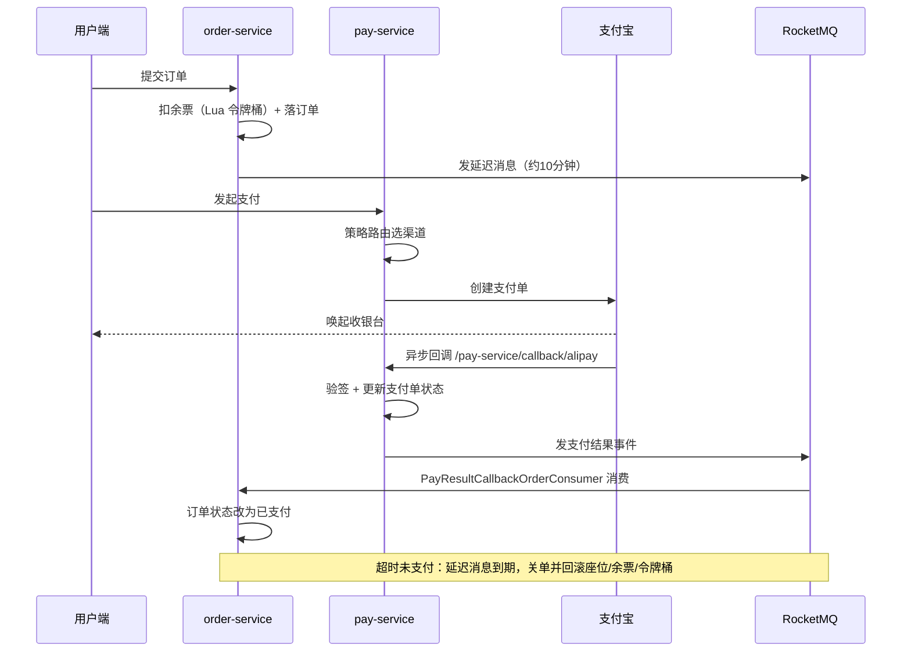

# 12306 订单支付模块（学习摘录）

课程实践里我负责订单支付模块，这个仓库是我从 index12306 里摘出来的相关代码，加上自己整理的链路笔记。

先把话说清楚：**这里不是完整工程，跑不起来**。完整的六个微服务在 [nageoffer/index12306](https://github.com/nageoffer/index12306)，代码是 Apache License 2.0，`LICENSE` 我原样拷了一份放在根目录。

配置里的支付宝密钥、数据库口令、回调地址都换成占位符了，只留结构，方便看代码。

## 只摘了这几个模块

原始工程有 user / ticket / gateway / aggregation 好几个服务，跟我负责的部分没关系，所以没搬。留下来的是读支付链路绕不开的：

```
.
├── services/
│   ├── pay-service/        # 支付服务：下单、回调、退款
│   └── order-service/      # 订单服务：状态流转、延迟关单发送、支付结果消费
├── frameworks/
│   ├── designpattern/      # 策略路由，支付渠道按「渠道_场景」选
│   └── idempotent/         # 幂等，注解 + AOP + Redis 令牌
├── resources/
│   ├── 12306-springcloud-pay.sql      # 支付域建表
│   └── 12306-springcloud-order.sql    # 订单域建表
├── docs/snippets/
│   ├── ticket_availability_token_bucket.lua           # 余票令牌桶，预扣
│   └── ticket_availability_rollback_token_bucket.lua  # 余票令牌桶，回滚
└── LICENSE
```

## 我做了什么

组里我担任组长，负责订单支付模块，具体是三件事：

1. **把整条链路跟通**：支付下单 → 支付宝回调 → MQ 通知订单 → 订单变成已支付。一开始我不理解「支付成功」和「订单已支付」为什么是两个动作，跟着断点走了一遍才明白中间隔着一个 MQ。
2. **退票和取消支付**：这两个分支调的时间最长，涉及延迟关单的消费和 Redisson 加锁防重复取消。发送侧 `DelayCloseOrderSendProduce.java` 在本仓库，消费侧 `DelayCloseOrderConsumer.java` 在 ticket-service，我没有摘过来，只把余票令牌桶的两个 Lua 放进了 `docs/snippets/`。
3. **答辩讲稿**：策略路由、幂等、延迟关单、三层防超卖这几块，逐行讲了一遍。

核心实现都是上游写的，我做的事情更偏「读懂、调通、讲清楚」。这一点我不打算含糊，所以写在这儿。

## 支付链路



## 代码在哪

路径中间用 `...` 省略了包名，搜索类名能直接定位。

| 想看什么 | 文件 |
| --- | --- |
| 支付下单入口 | `services/pay-service/.../controller/PayController.java` |
| 支付业务编排 | `services/pay-service/.../service/impl/PayServiceImpl.java` |
| 渠道策略实现 | `services/pay-service/.../handler/AliPayNativeHandler.java` |
| 回调验签与幂等 | `services/pay-service/.../handler/AliPayCallbackHandler.java`、`controller/PayCallbackController.java` |
| 退款 | `services/pay-service/.../handler/AliRefundNativeHandler.java`、`service/RefundService.java` |
| 策略路由框架 | `frameworks/designpattern/.../strategy/AbstractStrategyChoose.java` |
| 幂等框架 | `frameworks/idempotent/.../core/IdempotentAspect.java`、`annotation/Idempotent.java` |
| 支付结果发出去 | `services/pay-service/.../mq/produce/PayResultCallbackOrderSendProduce.java` |
| 订单侧消费支付结果 | `services/order-service/.../mq/consumer/PayResultCallbackOrderConsumer.java` |
| 延迟关单发送 | `services/order-service/.../mq/produce/DelayCloseOrderSendProduce.java` |
| 订单分片算法 | `services/order-service/.../dao/algorithm/OrderCommonDataBaseComplexAlgorithm.java` |
| 支付分片算法 | `services/pay-service/.../dao/algorithm/PayDataBaseComplexAlgorithm.java` |
| 余票令牌桶 | `docs/snippets/ticket_availability_token_bucket.lua`（原属 ticket-service） |

## 读的时候想明白的几件事

**支付回调只带订单号，怎么找到分片后的那条订单？**

订单按 `user_id` + `order_sn` 复合分片，2 库 × 32 表。用户查自己的订单带 `user_id`，路由没问题。但支付回调回来只有 `order_sn`，这时候算不出该去哪个库哪张表。项目的解法是生成订单号时把 `user_id` 尾部几位拼进去，回调侧再从订单号里把这段读出来，路由信息就跟着 ID 走了。我当时看到这段才反应过来，分片键不一定非得是查询条件，也可以提前「写进」业务 ID 里。

**重复回调、重复点击怎么办？**

两道防线。接口层 `@Idempotent` 注解加 AOP 拦截，Redis 令牌做首次占用；消费层按消息唯一键去重。刚开始我觉得幂等是优化项，后来理解到回调本来就可能重复送达，不幂等就是错的。

**超时关单为什么用延迟消息，不扫表？**

数据量一大，扫表既有延迟又有全表压力，延迟消息把「到期」交给 MQ 投递，到点就触发关单。麻烦的是关单要联动回滚三处：DB 座位、Redis 余票缓存、令牌桶。漏一处就会出现票释放了但余票没加回去的脏数据，所以关单和取消都用 `Redisson tryLock` 挡住并发重复回滚。

## 来源

- 代码版权归 [nageoffer](https://github.com/nageoffer) 及贡献者，Apache License 2.0；
- 这里只是个人学习记录，不能拿去上生产；
- 想真跑起来要自己搭 Nacos、RocketMQ、Redis、MySQL、ShardingSphere，原项目文档里有步骤。
