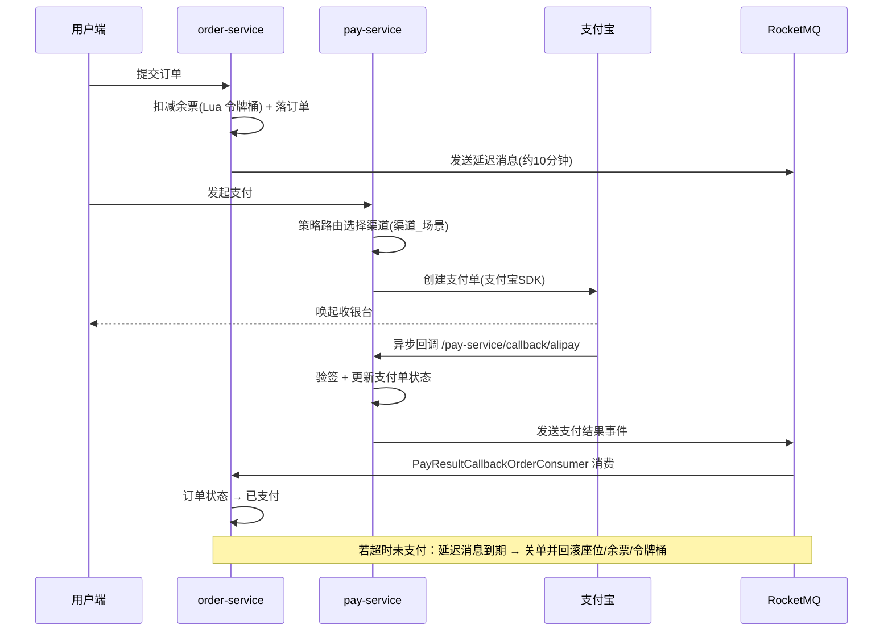

# 12306 订单支付模块 · 学习实践摘录

> **本仓库不是完整可运行工程。** 它是本人课程实践中，针对订单与支付链路整理的**源码摘录 + 导读**，用于展示我对这段业务的理解路径。
> 原始完整工程：[nageoffer/index12306](https://github.com/nageoffer/index12306)，代码遵循 **Apache License 2.0**（`LICENSE` 已随仓库保留）。
> 仓库内的配置项（支付宝密钥、数据库口令、回调地址）**已全部脱敏**为占位符，仅保留结构用于阅读。

## 为什么只摘这几个模块

`index12306` 是六个微服务的完整购票系统，`user / ticket / gateway / aggregation` 等服务与本次实践无关。这里只保留我实际参与的部分：

```
.
├── services/
│   ├── pay-service/        # 支付服务：支付下单、回调、退款
│   └── order-service/      # 订单服务：订单状态流转、超时关单消费、退款回调消费
├── frameworks/
│   ├── designpattern/      # 策略路由框架（支付渠道按「渠道_场景」动态选择）
│   └── idempotent/         # 幂等框架（注解 + AOP + Redis 令牌）
├── resources/
│   ├── 12306-springcloud-pay.sql      # 支付域表结构（分库分表规则）
│   └── 12306-springcloud-order.sql    # 订单域表结构
├── docs/snippets/
│   ├── ticket_availability_token_bucket.lua           # 余票令牌桶：原子预扣
│   └── ticket_availability_rollback_token_bucket.lua  # 余票令牌桶：回滚
└── LICENSE
```

## 本人职责

担任课程项目组长，负责**订单支付模块**：

1. **链路调试**：用断点跟完「支付下单 → 渠道回调 → MQ 通知订单 → 订单状态流转」全流程，定位并梳理各环节的状态与数据一致性边界；
2. **退票 / 取消支付**：调试延迟关单链路（发送侧 `DelayCloseOrderSendProduce.java` 在本仓库；消费侧 `DelayCloseOrderConsumer.java` 位于 ticket-service，**未摘录**，仅将余票令牌桶 Lua 放入 `docs/snippets/`），以及 Redisson 加锁防重复取消的并发场景；
3. **方案讲解**：撰写模块答辩讲稿，逐行讲解支付策略路由、幂等、延迟关单与三层防超卖的实现取舍。

> 说明：模块的核心实现来自上游开源工程，本仓库的增量价值在于**导读、调试记录与链路梳理**——下面的时序图与「代码在哪」对照表就是为此而写。

## 支付链路时序



## 代码在哪（对着看比读文档快）

| 关注点 | 文件 |
| --- | --- |
| 支付下单入口 | `services/pay-service/.../controller/PayController.java` |
| 支付业务编排 | `services/pay-service/.../service/impl/PayServiceImpl.java` |
| 渠道策略实现 | `services/pay-service/.../handler/AliPayNativeHandler.java` |
| 回调验签与幂等 | `services/pay-service/.../handler/AliPayCallbackHandler.java`、`controller/PayCallbackController.java` |
| 退款 | `services/pay-service/.../handler/AliRefundNativeHandler.java`、`service/RefundService.java` |
| 策略路由框架 | `frameworks/designpattern/.../strategy/AbstractStrategyChoose.java` |
| 幂等框架 | `frameworks/idempotent/.../core/IdempotentAspect.java`、`annotation/Idempotent.java` |
| 支付结果通知订单 | `services/pay-service/.../mq/produce/PayResultCallbackOrderSendProduce.java` |
| 订单侧消费支付结果 | `services/order-service/.../mq/consumer/PayResultCallbackOrderConsumer.java` |
| 延迟关单发送 | `services/order-service/.../mq/produce/DelayCloseOrderSendProduce.java` |
| 订单分片算法（基因法） | `services/order-service/.../dao/algorithm/OrderCommonDataBaseComplexAlgorithm.java` |
| 支付分片算法 | `services/pay-service/.../dao/algorithm/PayDataBaseComplexAlgorithm.java` |
| 余票令牌桶 Lua | `docs/snippets/ticket_availability_token_bucket.lua`（原属 ticket-service） |

## 这段业务里我认为最值得讲的三件事

**1. 支付回调只带订单号，怎么找到分片后的那条订单？**
订单按 `user_id` + `order_sn` 复合分片（2 库 × 32 表）。用户查订单带 `user_id` 能正常路由，但支付回调只回传 `order_sn`，此时单靠订单号算不出分片位置。项目用**基因法**：生成订单号时把 `user_id` 的尾数融进订单号本身，于是回调侧能反推出路由信息——相当于把分片键"纹"进了 ID。

**2. 重复回调 / 重复点击怎么办？**
两条防线：接口层 `@Idempotent` 注解 + AOP 拦截，以 Redis 令牌做「首次占用」；消费层用 MQ 幂等注解，按消息唯一键去重。幂等在这里不是可选优化，而是**回调可能重复送达**这一事实的必然要求。

**3. 超时关单为什么要用延迟消息，不用定时扫表？**
扫表在数据量大时会有延迟与全表压力；延迟消息把「到期」交给 MQ 精确投递，到期即触发关单消费。关单还要联动回滚三处状态：DB 座位、Redis 余票缓存、令牌桶——**任一处漏掉都会造成"票已释放但余票不增"的脏数据**，所以关单与取消都用 `Redisson tryLock` 防止并发重复回滚。

## 免责与致谢

- 代码版权归原作者 [nageoffer](https://github.com/nageoffer) 及贡献者，遵循 Apache License 2.0；
- 本仓库仅作个人学习记录与技术交流，**不建议用于生产**；
- 如需完整可运行环境（Nacos、RocketMQ、Redis、MySQL、ShardingSphere 等），请参照原项目文档搭建。
